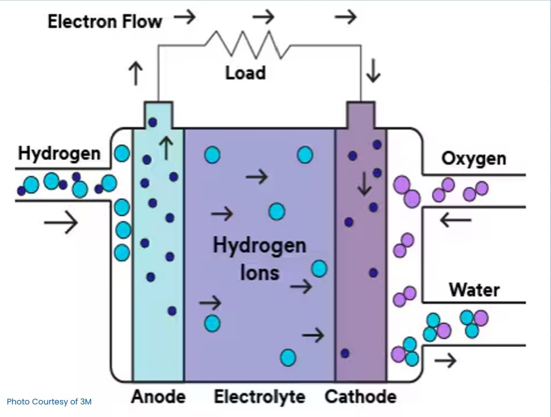
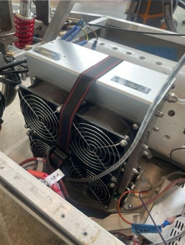
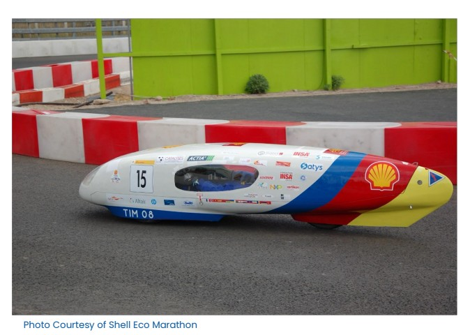
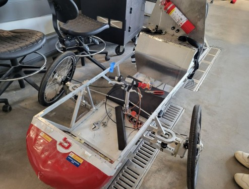
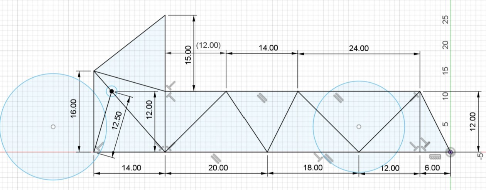

## Table of contents

:::: {.columns}

::: {.column width="33%" style="display: flex; flex-direction: column; justify-content: center; height: 100%;"}
::: {.callout-note}
01
:::

Introduction
:::

::: {.column width="33%" style="display: flex; flex-direction: column; justify-content: center; height: 100%;"}
::: {.callout-note}
02
:::

Current Project
:::

::: {.column width="33%" style="display: flex; flex-direction: column; justify-content: center; height: 100%;"}
::: {.callout-note}
03
:::

Future Considerations
:::

::::

## 01 Introduction

::: {.callout-note}
What is a HFCV? And why is there one sitting in the High Bay?
:::

## What you need to know first

::::{.columns}

::: {.column width="50%" style="display: flex; flex-direction: column; justify-content: center; height: 100%;"}

Hydrogen (H~2~) as a fuel?
  - H~2~ is an energy carrier (like gasoline)
  - Energy is produced through electrolysis
  - Stored as a liquid before entering the fuel cell

:::

::: {.column width="50%" style="display: flex; flex-direction: column; justify-content: center; height: 100%;"}

Why switch to H~2~
   - H~2~ is incredibly energy dense
   - Clean in comparison to gas
   - Large range before needing to refuel

:::

::::

## Inside the Fuel Cell

{width="6.5in" height="4.319444444444445in"}

**Our Actual Fuel Cell**

{width="6.5in" height="4.319444444444445in"}

## Shell Eco Marathon

:::: {.columns}

::: {.column width="40%" style="display: flex; flex-direction: column; justify-content: center; height: 100%;"}

**What Is It?**

Competition to make the most energy efficient vehicle

**Why Compete?**

Gives a target for our work on the vehicle

:::

::: {.column width="60%" style="display: flex; flex-direction: column; justify-content: center; height: 100%;"}

{width="6.5in" height="4.319444444444445in"}

:::

::::

## 02 Current Project

::: {.callout-note}
Rebuilding the Chassis
:::

## Before This Summer

:::: {.columns}

::: {.column width="60%" style="display: flex; flex-direction: column; justify-content: center; height: 100%;"}

- Previous vehicle
  - No longer adheres to Shell’s safety standards
  - Needs a complete rebuild before competition ready

- Revitalization w/ Ben, Jano, and Justin
  - Materials testing
  - Preliminary Chassis Design
  - Rear Brakes and Suspension system

:::

::: {.column width="40%" style="display: flex; flex-direction: column; justify-content: center; height: 100%;"}

{width="6.5in" height="4.319444444444445in"}

:::

::::

## Rough Design From Ben and Justin

{width="6.5in" height="4.319444444444445in"}

## Goal:

**New Front End**

## What will that take?

::: {.timeline .vertical-alt}
::: {.event data-label="1"}
**Fabrication Techniques**
Learning how to weld, 3D print, and lathe
:::

::: {.event data-label="2"}
**Choosing Components**
What suspension to use? What size of wheels to use?
:::

:::{.event data-label="3"}
**Front Chassis Design**
Using the general idea left by Ben and Justin, create a new design
:::

:::{.event data-label="4"}
**Construction**
Actually putting together the front end
:::

:::{.event data-label="5"}
**Completion**
:::

:::

## 03 Future Considerations

::: {.callout-note}
Rebuilding the rest of the HFCV
:::

## Fall 2024

:::: {.columns}

::: {.column width="33%" style="display: flex; flex-direction: column; justify-content: center; height: 100%;"}
**Rear of Chassis**

Build and fit the rear wheel + suspension system
:::

::: {.column width="33%" style="display: flex; flex-direction: column; justify-content: center; height: 100%;"}
**Electrical Components**

Wire the new car and put in the hydrogen system
:::

::: {.column width="33%" style="display: flex; flex-direction: column; justify-content: center; height: 100%;"}
**Floor of Vehicle**

Purchase components and assemble
:::

::::

## Spring 2025

:::: {.columns}

::: {.column width="33%" style="display: flex; flex-direction: column; justify-content: center; height: 100%;"}
**Cowl Design and Build**

Build the cowl for the vehicle so that it is not a skeleton
:::

::: {.column width="33%" style="display: flex; flex-direction: column; justify-content: center; height: 100%;"}
**Testing**

Testing entire system to the Shell Eco Marathon Requirements
:::

::: {.column width="33%" style="display: flex; flex-direction: column; justify-content: center; height: 100%;"}
**Compete**

Transport Team and Car to Indiana
:::

::::

## Thank you for listening

::: {.callout-note}
Questions, Comments, Concerns?
:::

<njiang1@swarthmore.edu>

<avasque1@swarthmore.edu>

<ceverba1@swarthmore.edu>